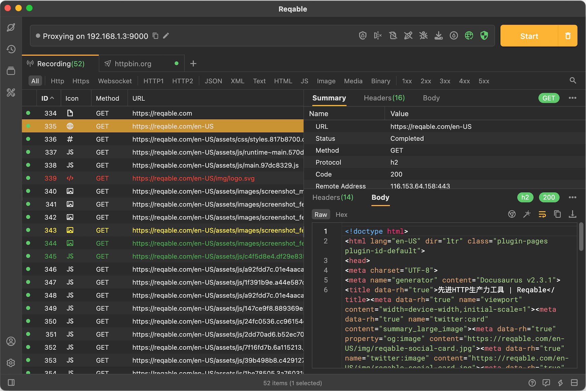
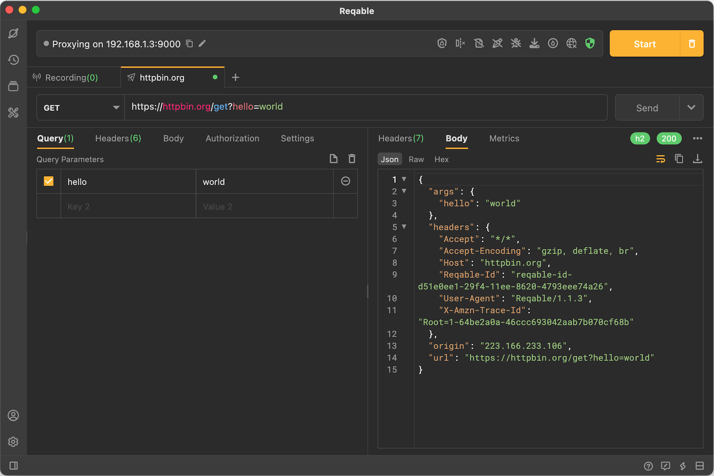
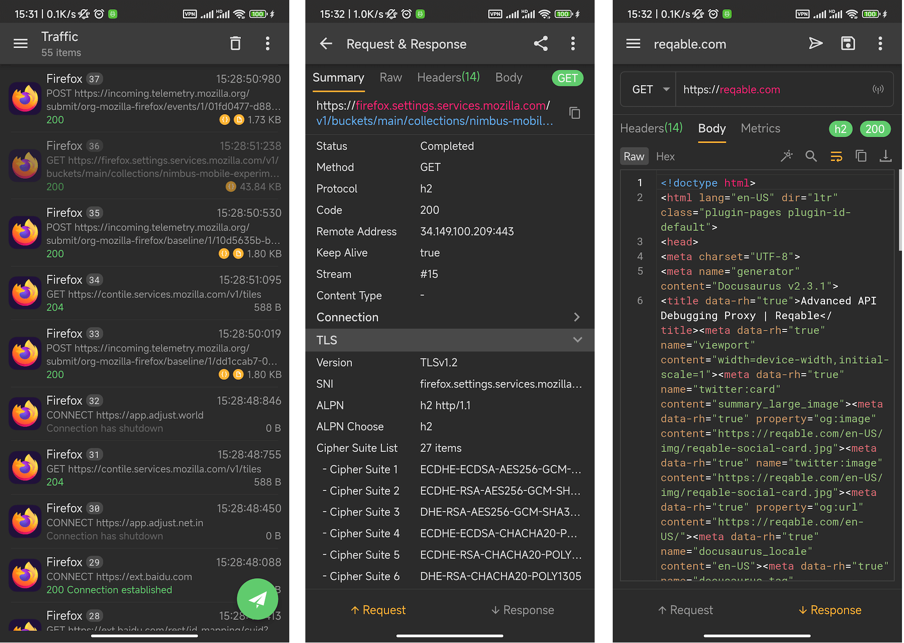
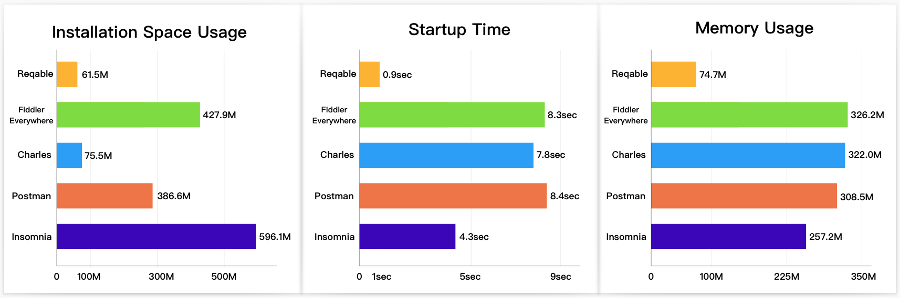

# Reqable

[English](README.md) | [简体中文](README_CN.md) | [繁體中文](README_ZH-HANT.md) | [日本語](README_JA.md) | [한국어](README_KO.md) | [Español](README_ES.md) | [Français](README_FR.md) | [Deutsch](README_DE.md) | [Русский](README_RU.md)

⚠️ **注意：Reqable 非開源專案，本倉庫僅用來管理需求與使用者回饋。**

## 關於

[Reqable](https://reqable.com/) 是新一代 API 除錯 + API 測試一站化解決方案。Reqable 具有全平台、免登入、輕量級、高效能、無廣告等優點，理念是讓 API 更快更簡單，助力程式開發與測試人員提高生產力！現已支援 `Windows`、`Mac`、`Linux`、`Android` 和 `iOS` 五大平台。

Reqable = API 抓包工具 + API 測試工具，兩者深度整合，抓測一體，操作簡單，一個工具頂多個工具。

Reqable 絕大多數功能均可免費使用，沒有試用期限，社群版本適合輕度使用者；如果你是功能重度使用者，可能需要購買我們的高級會員。

歡迎造訪我們的官方網站：https://reqable.com

## 目錄

- [關於](#關於)
- [API 除錯](#api-除錯)
- [API 測試](#api-測試)
- [MCP 支援](#mcp-支援)
- [極致效能](#極致效能)
- [行動版 App](#行動版-app)
- [安裝](#安裝)
- [文件](#文件)
- [致謝](#致謝)

# API 除錯

Reqable 採用經典的 MITM（中間人）方式對 HTTP(S) 請求進行抓包，在桌面端使用系統代理的方式攔截流量，在移動端則使用 VPN 的方式攔截流量。Reqable 支援對抓包資料進行除錯操作，例如重放、編輯、中斷點、重寫、指令碼等。

# API 測試

Reqable 可以編輯、傳送和管理 `HTTP`、`WebSocket`、`SSE` 和 `gRPC`（即將上線）請求，支援 API 集合、環境變數、文件管理和雲端同步等功能。

# MCP 支援

Reqable 提供了內建 MCP 伺服器，你可以將 AI 助手（如 Claude、Copilot）與 Reqable 連接起來，從而實現 AI 驅動的介面除錯、流量分析、規則建立等功能。

MCP 伺服器程式碼我們是完全開源的，詳見 [MCP Server](https://github.com/reqable/reqable-mcp-server)。

# 極致效能

Reqable 基於 Flutter 和 C++ 開發，拒絕內建瀏覽器，不僅安全性高，相比同類產品還具有極大的效能優勢。

- 速度快，毫秒級啟動。
- 安裝空間小，不足 100M。
- 記憶體占用低，日常低於 300M。

封包擷取效能基準測試

API 用戶端效能基準測試

> 以上資料是在蘋果最新的 MacBook Pro M5 裝置上的測試結果，在硬體效能較差的裝置上，Reqable 的效能優勢更加明顯。

# 行動版 App

行動端和桌面端功能基本保持一致，同時支援 API 除錯和 API 測試。同時，支援手機掃碼新增電腦裝置，將手機流量轉發到電腦端進行操作。

登入後啟用雲端資料儲存，可以在不同裝置之間自動同步資料。

> 中斷點、重寫和指令碼功能擔心引起濫用暫未上線。

## 已知問題

### 安卓模擬器協同控制（Windows 端）出現封包錯亂問題

**問題描述：**

在 Windows 端使用安卓模擬器進行協同控制時，可能出現請求與響應不匹配（「驢頭不對馬嘴」）的問題，即抓包資料顯示的請求內容與實際響應內容不對應。

**問題原因：**

此問題是由於安卓模擬器與 Windows 端之間的網路通訊在某些情況下會發生封包順序混亂，導致請求與響應的對應關係錯誤。

**解決方案：**

此問題已記錄，開發團隊正在積極修復中。在修復版本發布之前，建議：

1. 嘗試重新啟動協同控制連線。
2. 減少同時進行的網路請求數量。
3. 如果問題持續出現，請提交詳細的重現步驟至 [Issues](https://github.com/reqable/reqable-app/issues)。

# 安裝

| 平台 | 架構 | 格式 | 下載與安裝 | 說明 |
| ---- | ---- | ---- | ---- | ---- |
| **Windows** | x86_64 | exe | [下載](https://app.reqable.com/download?platform=windows&arch=x86_64&ext=exe&locale=en-US) | 安裝程式版本（建議），支援 `Windows 7+`。 |
| **Windows** | x86_64 | zip | [下載](https://app.reqable.com/download?platform=windows&arch=x86_64&ext=zip&locale=en-US) | 可攜式版本，支援 `Windows 7+`。 |
| **Mac** | universal | - | brew install reqable | 需要 macOS `11.0` 或更新版本。 |
| **Mac** | Intel Chip | dmg | [下載](https://app.reqable.com/download?platform=macos&arch=x86_64&ext=dmg&locale=en-US) | Intel 晶片，需要 macOS `11.0` 或更新版本。 |
| **Mac** | Apple Silicon | dmg | [下載](https://app.reqable.com/download?platform=macos&arch=arm64&ext=dmg&locale=en-US) | M 系列晶片，需要 macOS `11.0` 或更新版本。 |
| **Linux** | x86_64 | deb | [下載](https://app.reqable.com/download?platform=linux&arch=x86_64&ext=deb&locale=en-US) | 支援 `Ubuntu`、`Debian` 及其他發行版。需要 `GTK 3.0`。 |
| **Linux** | x86_64 | AppImage | [下載](https://app.reqable.com/download?platform=linux&arch=x86_64&ext=AppImage&locale=en-US) | 支援 `Ubuntu`、`Debian` 及其他發行版。需要 `GTK 3.0`。 |
| **Android** | universal | - | [Google Play](https://play.google.com/store/apps/details?id=com.reqable.android) | 需要 `Android 5.0` 或更新版本。 |